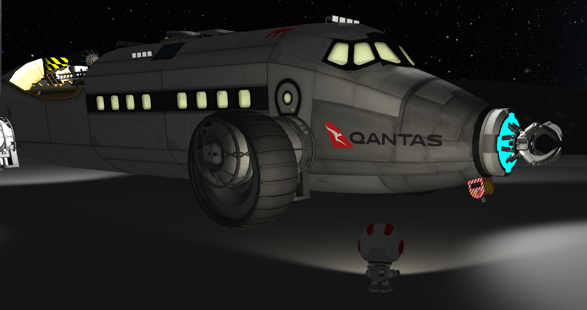
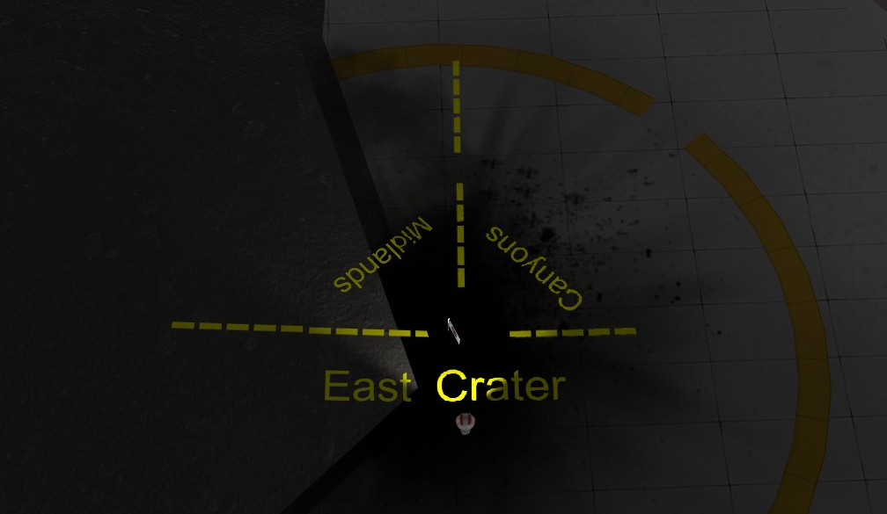

# KSP Graffiti Artist

Paint text and pictures directly onto vessels already in service, planetary surfaces and Kerbal Konstructs objects in Kerbal Space Program.

An EVA Kerbal equips a spray can from KIS inventory and right-clicks a nearby surface to create, edit or erase a marking. No separate decal plate or pre-launch preparation is required. Any Kerbal can use the can; it is not restricted to Engineers.

**Current release: 0.2.5 — KSP 1.12.5 on Windows.** Vessel labels, KK painting and image use have been demonstrated in game. See the [validation notes](docs/VALIDATION.md) for individual regression checks and test limitations.

## In-game examples

### Vessel branding

Apply a custom image to a vessel already in service. Here, a Qantas logo follows the curved hull beside the cockpit.

### Surface wayfinding

Combine coloured text and markings to identify biomes at a surface base. These painted markings show a tri-biome location at a Kerbal Konstructs landing pad, with paint on both the Mun surface and a KK object.

## Requirements

- **Kerbal Space Program 1.12.5 on Windows.** Linux and macOS are not validated; the registered-font fallback uses Windows APIs.
- **Kerbal Inventory System (KIS)** — built against KIS 1.29 and its bundled KSPDev utilities. Install KIS normally; the release does not bundle these dependencies.
- **ModuleManager**, required to enable painting on vessel parts.
- **Kerbal Konstructs is optional**, needed only for painting KK instances.

Conformal Decals is not required. Stock EVA inventory is not supported; use KIS inventory.

## Installation

1. Install KIS and ModuleManager, then close KSP.
2. Download **KSPGraffitiArtist-0.2.5.zip** from the [latest release](https://github.com/maddavo/KSPGraffitiArtist/releases/latest). The source ZIPs are for development and do not contain the compiled plugin.
3. Extract the ZIP and copy its `GameData/KSPGraffitiArtist` folder into your KSP installation's `GameData` folder. The plugin should be at `GameData/KSPGraffitiArtist/Plugins/KSPGraffitiArtist.dll`.
4. Start KSP and find **GA-1 Graffiti Artist Spray Can** in Utility. In career mode it unlocks at **Engineering 101**, costs 25 funds and occupies 0.8 L in KIS inventory. Cans can stack in KIS inventories.

Back up your save before installing or updating. When updating, preserve your custom `Images` files and replace the addon files with the new release. CKAN indexing has not yet been requested; use manual installation for this release.

## Painting

1. Carry a spray can in the Kerbal's KIS inventory and equip it in the right hand on EVA.
2. Right-click a vessel part, KK instance or solid planetary surface within **3 m** to open the paint editor.
3. Enter text and choose an installed font, style and colour, or select a PNG picture. Inspect the preview on the surface.
4. Adjust placement with the controls below, then choose **Apply** or **Cancel**.
5. Right-click an existing marking with the can equipped to edit or erase it.

| Control | Action |
| --- | --- |
| I / J / K / L | Move up / left / down / right along the placement surface |
| Q / E | Rotate |
| A / D | Decrease / increase width |
| Alt + right-click | Open the normal part menu |
| Escape | Cancel the current edit |

When the text box has focus, these keys type normally. Click another editor control to use the placement keys. Reach is distance-only; the Kerbal does not need a separate line-of-sight check. Mouse targeting still selects the first nearby physical surface under the pointer.

Font styles are Regular, Bold, Italic and Bold Italic. User-installed Windows TTF/OTF fonts are included in the picker; opening it refreshes the list. If Unity cannot load a registered font dynamically, the Windows fallback renders that font's coverage. Unsupported or unavailable fonts are reported in the editor.

The can does not consume paint. Applied markings do not require the can to remain equipped.

## Custom images

Copy pictures into `GameData/KSPGraffitiArtist/Images`, then click **Refresh pictures** in the editor. No restart is needed.

- PNG format, up to **2048 pixels in either dimension** and **4 MiB per file**.
- Transparency is supported; image colours and aspect ratio are retained.
- Up to 64 filenames are listed; decoded images share a 64 MiB cache budget.
- A transparent `direction-arrow.png` is included for testing. The logo shown in the screenshot is not bundled as a paint image.

Resize oversized images before using them. Missing or invalid files produce an unavailable-image message; keep custom images at the same filenames so saved markings can find them.

## Persistence and limitations

Vessel markings are stored on their painted parts. KK and terrain markings are stored in the current save: KK paint is tied to the instance UUID, and terrain paint uses body coordinates. Removing a KK instance does not reassign its markings to another object.

Painting uses readable visible meshes. Animated, rescaled, deployable and variant-switched parts, terrain LOD transitions and unusual third-party geometry may need additional testing. Paint that extends beyond the selected surface may be clipped. See [world surfaces](docs/WORLD-SURFACES.md) and the [validation notes](docs/VALIDATION.md) for details.

Keep save backups before removing the mod: saving without its modules can discard marking records. Custom PNGs and fonts are not embedded in saves. Player-supplied fonts are not redistributed with the mod.

## Development and support

Report problems through [GitHub Issues](https://github.com/maddavo/KSPGraffitiArtist/issues), including the mod version, KSP version and relevant `GraffitiArtist` lines from `KSP.log`. Remove private information before attaching logs or saves.

- [Build and package instructions](docs/PROTOTYPE.md)
- [Design](docs/DESIGN.md)
- [Validation notes](docs/VALIDATION.md)
- [Changelog](CHANGELOG.md)

## Licence

Project code, documentation and original spray-can assets are released under the [MIT licence](LICENSE), copyright 2026 maddavo. Third-party game artwork, logos and trademarks visible in example screenshots remain the property of their respective owners. Dependencies and player-supplied fonts and images retain their own licences.
